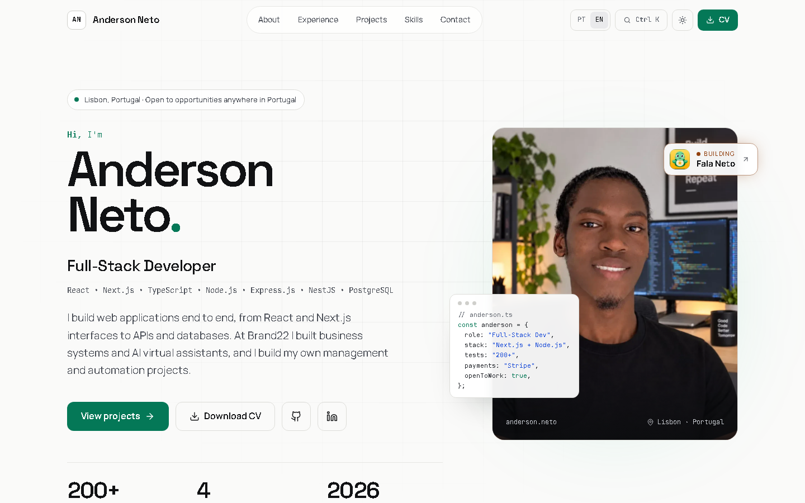

# Anderson Neto — Developer Portfolio

Personal portfolio for **Anderson Neto**, Full-Stack Developer based in Lisbon, Portugal.

The website presents selected projects, professional experience, technical skills, education and contact information, with a focus on Full-Stack, Frontend and Software Developer opportunities.

## Portfolio highlights

- Brand22 CRM — internal CRM in production
- Brand22 chatbot and the CIMAT and AMAT AI assistants — live on their websites
- Fala Neto — mobile app to learn African languages (in development)
- Garimpo — real-time Vinted alerts on Telegram, 200+ automated tests
- RHNeto Pro — final course project, top grade 20/20
- STP Market and Portfolio Analytics
- Portuguese and English versions, plus a page for freelance clients

## How the site is built

- Plain HTML, CSS and JavaScript — no framework and no build step
- Project details rendered from JSON: problem, solution, features, technical decisions and architecture
- Screenshot albums for the main projects
- Light and dark themes, Ctrl+K command palette and keyboard navigation
- Cookie-free analytics with GoatCounter and custom events (CV download, contact, project opened)

## Core stack

React · Next.js · TypeScript · JavaScript · Node.js · Express.js · NestJS · PostgreSQL · MySQL · REST APIs

## Live website

[andersonneto.gt.tc](https://andersonneto.gt.tc)

## Professional links

[LinkedIn](https://linkedin.com/in/anderson-fullstack-developer) · [GitHub](https://github.com/anderson-fullstack-developer)

## Purpose

This repository contains the source code for my professional portfolio. The site is intended to give recruiters and engineering teams a concise overview of my experience, projects and technical background.
